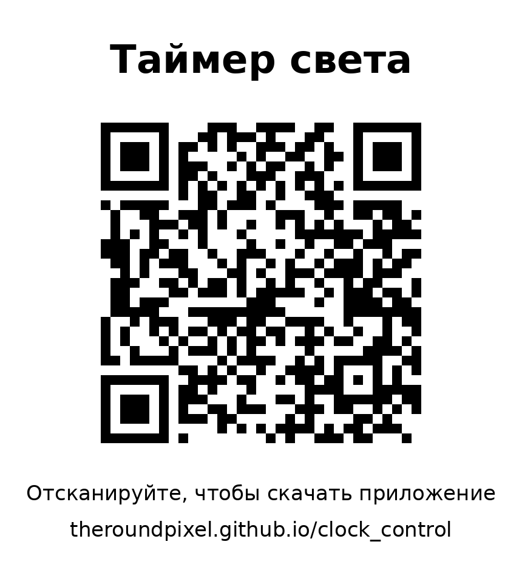

# Таймер света на Arduino

Устройство включает и выключает питание светодиодной ленты по расписанию.
Расписание задаётся с телефона на Android через Bluetooth.

**📲 Скачать приложение (открывается в браузере): https://theroundpixel.github.io/clock_control/**



---

## Как это работает

- **Часы DS1302** с батарейкой CR2032 хранят время, даже когда устройство отключено от сети.
- **Arduino Nano** раз в секунду сверяет время с расписанием и включает или выключает **твердотельное реле**.
  Реле подаёт 220 В на блок питания ленты.
- **Модуль HC-06** принимает команды с телефона по Bluetooth.
- Расписание хранится в памяти EEPROM внутри Arduino и не пропадает при отключении питания.
- После пропадания света реле сразу встаёт в положение, которое положено по расписанию на текущий момент.
- В расписании до 8 правил: время включения, время выключения и дни недели.
  Поддерживаются интервалы через полночь (например, 18:00 → 01:00).
  Каждое правило можно временно отключить, не удаляя.
- Ручное включение или выключение действует до следующего переключения по расписанию.

## Компоненты

| Компонент | Примечание |
|---|---|
| Arduino Nano (ATmega328P) | |
| Модуль часов DS1302 с батарейкой CR2032 | «MH-Real-Time Clock Modules-2» |
| Bluetooth-модуль HC-06 | Bluetooth 2.1, работает только с Android |
| Твердотельное реле 1 канал, 5 В, высокий уровень | Omron G3MB-202P, **только переменный ток**, до 2 А |
| Резисторы 1 кОм и 2 кОм | делитель напряжения для входа RXD модуля HC-06 |
| Блок питания 5 В для Arduino | USB-зарядка или модуль 220→5 В (например, HLK-PM01) |

## Подключение

| Модуль | Контакт | Arduino Nano |
|---|---|---|
| DS1302 | VCC / GND | 5V / GND |
| | CLK / DAT / RST | D5 / D6 / D7 |
| HC-06 | VCC / GND | 5V / GND |
| | TXD | D10 |
| | RXD | D11 **через делитель** (см. ниже) |
| Реле | DC+ / DC− / CH1 | 5V / GND / D4 |

Делитель для RXD модуля HC-06 нужен потому, что вход модуля рассчитан на 3,3 В:

```
D11 ──[ 1 кОм ]──┬── RXD (HC-06)
                 │
              [ 2 кОм ]
                 │
                GND
```

**Силовая часть.** Клеммы реле включаются в разрыв **фазного** провода 220 В, который идёт на блок питания ленты.
Цепь 12/24 В постоянного тока это реле коммутировать не может.

> ⚠️ 220 В опасно для жизни. Все соединения делайте при выключенном автомате,
> а силовую часть уберите в закрытый корпус.

## Состав репозитория

```
firmware/relay_timer/relay_timer.ino   — программа для Arduino Nano
android/                               — исходный код приложения для Android
site/index.html                        — страница скачивания приложения
.github/workflows/build.yml            — автоматическая сборка APK и публикация страницы
RelayTimer_QR.png                      — QR-код на страницу скачивания
```

## 1. Прошивка Arduino

1. Откройте `firmware/relay_timer/relay_timer.ino` в Arduino IDE.
2. Выберите плату **Arduino Nano**. Для китайских плат на CH340 выберите процессор **ATmega328P (Old Bootloader)**.
3. Нажмите «Загрузить». Сторонние библиотеки не нужны.

Устройством можно управлять и без приложения, текстовыми командами через монитор порта (9600 бод)
или любой Bluetooth-терминал. Список команд — в начале скетча и по команде `HELP`.

## 2. Приложение для Android

APK собирается автоматически на GitHub при каждом изменении файлов в репозитории.

Перед первой сборкой нужно один раз включить страницу скачивания:
**Settings → Pages → Build and deployment → Source: GitHub Actions**.
Если сборка упала до того, как вы это сделали, откройте её во вкладке **Actions** и нажмите **Re-run all jobs**.

Установка:

1. Отсканируйте QR-код или откройте https://theroundpixel.github.io/clock_control/ и нажмите «Скачать приложение».
2. Откройте скачанный файл и разрешите установку из этого источника.
   Предупреждение Play Защиты о неизвестном разработчике — это нормально: приложение собрано вами.
3. **Настройки → Bluetooth** → найдите **HC-06** → выполните сопряжение. PIN-код **1234** или **0000**.
4. Откройте «Таймер света», разрешите доступ к «Устройствам поблизости», нажмите **Подключить** и выберите HC-06.
   В следующий раз приложение подключится само.

При первом подключении время на Arduino синхронизируется с телефоном автоматически.
Новые версии приложения ставятся поверх старой, удалять приложение не нужно.

### Что умеет приложение

- Показывает, горит ли свет, и время следующего переключения по расписанию.
- Кнопки **Включить** и **Выключить** действуют до следующего переключения по расписанию.
  **Авто** сразу возвращает работу по расписанию.
- Показывает часы устройства и насколько они расходятся с телефоном. Кнопка синхронизирует время одним нажатием.
- Расписание выглядит как карточки. Время выбирается на циферблате, как в будильнике.
  Есть выбор дней недели и готовые наборы «Каждый день», «Будни», «Выходные».
  Каждое правило можно временно отключить переключателем.

## Полезно знать

- Часы DS1302 уходят на несколько секунд в сутки. Приложение показывает расхождение,
  и время поправляется кнопкой «Синхронизировать с телефоном».
- У твердотельного реле есть небольшой ток утечки. С некоторыми блоками питания лента может
  еле заметно мерцать в выключенном состоянии.
- Реле на 2 А подходит для блоков питания ленты примерно до 100 Вт. Для более мощных нужно реле помощнее.
